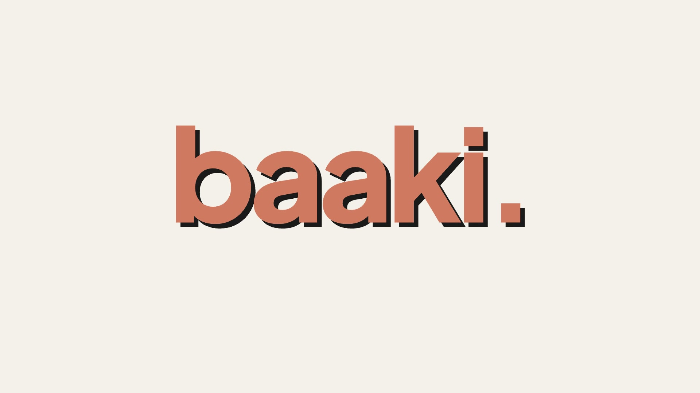
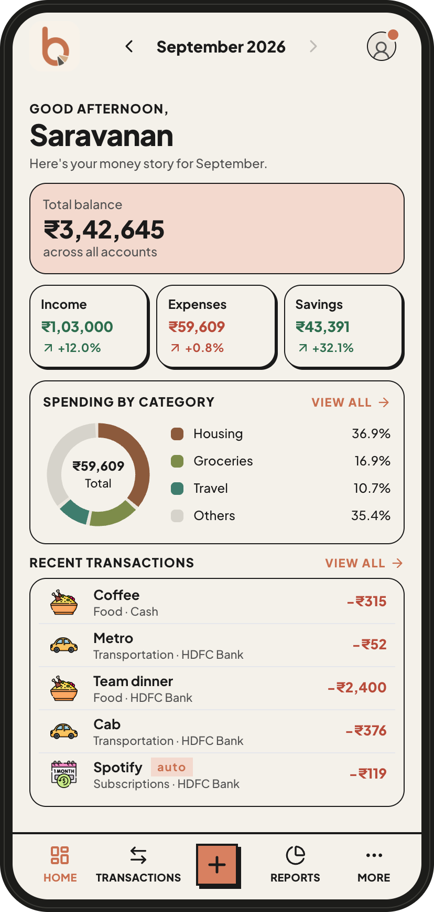
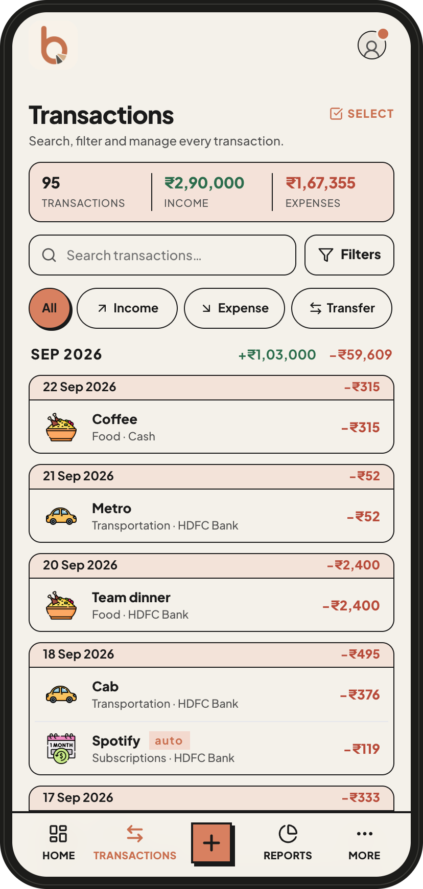
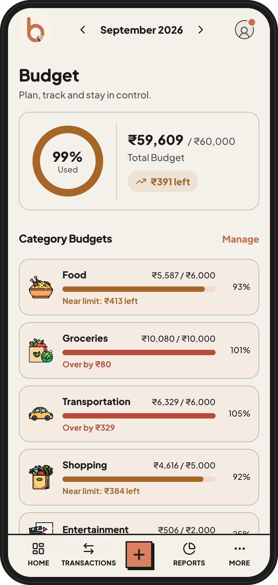

<h1 align="center">baaki</h1>

<b>Know where your money goes.</b> 
A personal finance app for India. It runs entirely on your phone: no account, no server, no internet.

   
  ▶ Watch the 25-second launch video

  
  
  

**[Download the APK](https://github.com/pvsaravanan/baaki/releases/latest)** (Android 7.0+) · [All screens and walkthrough](UI/README.md)

## License

MIT — see [LICENSE](./LICENSE). Profile pictures are [Open Peeps](https://www.openpeeps.com) by Pablo Stanley (CC0), drawn with [DiceBear](https://www.dicebear.com). Launch video music: Sascha Ende, [ende.app](https://ende.app/en) (CC BY 4.0).
